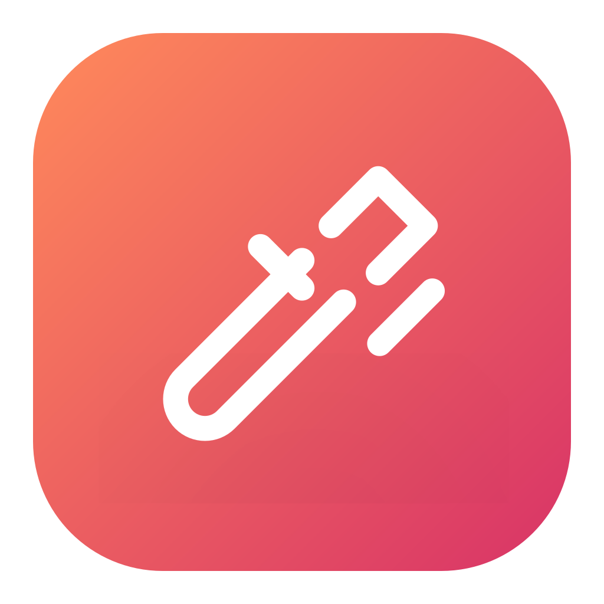
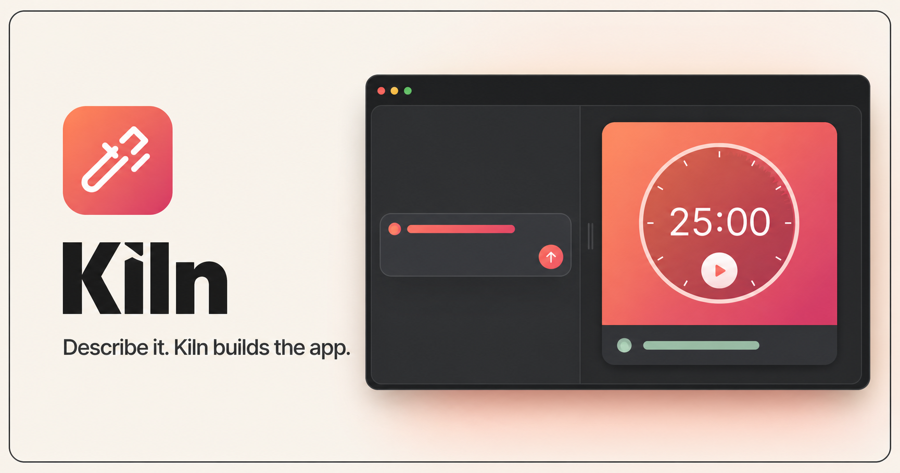

<div align="center">
  

  # Kiln

  **Describe it. Kiln builds the app.**

  A local-first macOS builder that turns plain-language prompts into real Mac apps and browser extensions.

  <a href="https://tanzir71.github.io/kiln/">Website</a> ·
  <a href="https://github.com/tanzir71/kiln/raw/refs/heads/main/release/Kiln-0.1.0-arm64.dmg">Download for Mac</a> ·
  <a href="SPEC.md">Specification</a>
</div>



> [!NOTE]
> Kiln is an early macOS release for Apple silicon. The package is validly ad-hoc signed, but it is not registered or notarized by Apple. On first launch, macOS requires approval in **System Settings → Privacy & Security → Open Anyway**.

## What is Kiln?

Kiln is a source-available alternative to hosted AI app builders. Describe the tool you want, choose Claude or Codex, and Kiln creates a normal local project that you can preview, revise, version, and export.

It can build:

- **Mac apps** using Electron, React, TypeScript, Tailwind CSS, and electron-builder.
- **Browser extensions** using WXT, React, TypeScript, and Tailwind CSS for Chrome/Edge and Firefox.

The generated code stays on your Mac. Each successful build is stored as a Git version, so you can inspect changes and return to an earlier iteration.

## Highlights

- Prompt, plan, build, preview, and package from one desktop app.
- Use Claude Code or Codex through an existing subscription login.
- Bring an Anthropic or OpenAI API key instead, stored with Electron `safeStorage`.
- Export Mac apps as DMG/ZIP packages.
- Export browser extensions as store-ready Chrome and Firefox ZIP files.
- Preview generated apps and test exact extension exports in Chromium.
- Automatic validation and repair before a version is accepted.
- Local project files and Git-backed version history with one-click revert.

## How it works

1. Create a project and choose **Mac app** or **browser extension**.
2. Describe what you want in the chat and select Plan or Build mode.
3. Kiln runs the selected agent inside a pinned project template.
4. Type checking, linting, builds, and smoke checks validate the result.
5. A passing build becomes a new Git version.
6. Run it locally, keep iterating, or export the finished artifact.

## Requirements

- macOS on Apple silicon for the packaged Kiln application.
- Node.js 22 and npm for development.
- At least one configured engine:
  - [Claude Code CLI](https://code.claude.com/docs/en/overview), or
  - [OpenAI Codex CLI](https://learn.chatgpt.com/docs/codex/cli), or
  - an Anthropic/OpenAI API key configured inside Kiln.

## Run locally

```bash
npm install
npm run dev
```

The renderer can also run against its browser mock backend:

```bash
npm --prefix ui run dev
```

## Validate the project

Run the complete local quality gate:

```bash
npm run check
```

Useful individual commands:

```bash
npm run typecheck
npm run lint
npm run test
npm run test:e2e
```

The end-to-end suite creates disposable projects and may invoke installed agent CLIs and packaging tools.

## Package Kiln

```bash
npm run dist
```

The Apple-silicon DMG and ZIP are written to `release/`. Builds are ad-hoc signed so their bundle signatures remain valid when shared. Without a paid Apple Developer Program membership, recipients must approve the app once in **System Settings → Privacy & Security → Open Anyway**.

## Package a notarized release

Public releases require a `Developer ID Application` certificate plus one notarization credential strategy supported by `notarytool`:

- `APPLE_ID`, `APPLE_APP_SPECIFIC_PASSWORD`, and `APPLE_TEAM_ID`;
- `APPLE_API_KEY` (the `.p8` path), `APPLE_API_KEY_ID`, and `APPLE_API_ISSUER`; or
- a credential profile stored with `xcrun notarytool store-credentials`, exposed as `APPLE_KEYCHAIN_PROFILE`.

Then run:

```bash
npm run dist:notarized
```

The notarized release command refuses to build without the required credentials. It signs with hardened runtime, notarizes and staples the app and DMG, verifies the disk image, and requires Gatekeeper assessment to pass before reporting success.

## Project structure

```text
.
├── src/                 Electron main process and preload bridge
├── ui/                  React renderer and browser mock backend
├── templates/
│   ├── app-base/        Generated Mac app template
│   └── ext-base/        Generated browser extension template
├── harness/             Agent rules, capability recipes, and icon pipeline
├── e2e/                 End-to-end and packaging coverage
├── site/                Static product landing page
├── SPEC.md              Product and implementation specification
└── PROGRESS.md          Milestone status and verification notes
```

## Landing page and GitHub Pages

The landing page is a dependency-free static site in [`site/`](site/). Every push to `main` triggers [the Pages workflow](.github/workflows/pages.yml), which publishes that directory to GitHub Pages.

After connecting this project to its GitHub repository, enable **GitHub Actions** as the Pages source if the repository has not used Pages before.

For local preview:

```bash
python3 -m http.server 4173 --directory site
```

Then open <http://localhost:4173>.

## Current status

The implementation milestones in [`SPEC.md`](SPEC.md) are complete. See [`PROGRESS.md`](PROGRESS.md) for verified flows, observed tool differences, and current platform limitations.

## Security model

- Renderer processes use context isolation with Node integration disabled.
- Generated apps access operating-system features through typed preload bridges.
- API keys are encrypted through Electron `safeStorage` and are not stored in project files.
- Generated projects use pinned templates and dependency/locked-file validation.
- Subscription authentication remains inside the official Claude Code and Codex CLIs.

## Acknowledgements

Kiln is inspired by [Glaze by Raycast](https://www.glaze.app/) and the idea that personal software should be as easy to shape as a conversation. Kiln is an independent project and is not affiliated with Raycast.
